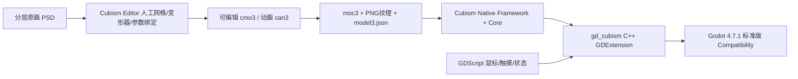

## 2026-11-05继续调查：Mao04多关节曲线适配试验

用户授权继续后，复用已在本机SDK压缩包中的Natori/Mao/Ren，不重复下载或接受许可。完整文件哈希在`.local/art_audio_r2/live2d_gesture_sources_20261105/sdk_natori_files.json`与`sdk_more_sources.json`。原资源保持字节一致；只在既有.local夹具展开，不建游戏clone/worktree，不升级引擎/桥接。

实际播放Natori05（5秒/150帧）、Mao04（4.2秒/126帧）、Ren03（8.533秒/256帧）。Natori05为掌心向上介绍姿态并有肘腕活动，起始仍淡入另一套手臂；不能当作自然连续抬臂成品。Ren03在当前已适配桥接下出现大块异常效果图层，未归因、不据此说原模型损坏，不继续扩大桥接修复。Mao04三个独立关节与头身协调变化，选作一次局部适配来源；[官方虹色Mao说明](https://www.live2d.com/en/learn/sample/niziiro-mao/)提供配套动画，并不是通用人形动作库。

当前鲸鱼娘原手势参数实机10组静态检查（`live2d_hand_refine_20261105/control_audit`）显示Param59透视、Param60小臂、Param61腕、Param62大臂各自有效，范围均为-1～1；原作者抚胸起手Param62只0～0.034。LArm/LForearm/LWrist由PhysicsSetting72输出，不强写它们。该检查只确定控制可用性，不证明所有组合无破绽或天然适合外部动作。

新组`GestureAudit_Mao04_Calibrated`是7.5秒实验：外层保留作者起手/收手，中段Mao mtn_04四点二秒；ParamArmLB01/02/03分别映射到Param62/60/61，比例/偏移为(0.01,0.10)/(0.01,0.55)/(0.025,0.002)，保留原曲线相对时序和贝塞尔形状。头身/眼脸取同一Mao来源；身体转角只映射Position输入，继续使用原物理。Mao原文件SHA256 `a95f67d35c81755dee7f3be1e5e60171f090026725f628c99a1e3585985a1ac1`。没有独立耸肩/掌面翻转/指形等价映射，深度沿用原姿态，不称完整重定向或专业动作通过。

代码/构造记录/20通道范围与时间检查/原始逐帧图/预览回Idle日志/可解码视频校验均在`live2d_gesture_sources_20261105`。`before_after_official_gesture_30fps.mp4`同机位左旧右新，旧版5秒后明确保持末帧，右侧7.5秒完整。原默认入口不变，另有“启动官方动作适配试验.cmd”和新增对照按钮。当前是可供审美验收的候选，不因225帧成功或手臂变化更多就标自然度通过；原起手姿态切换也仍存在。

其它检索结果：

- [Sapphire 40反应动作包](https://vgen.co/ShadowPhoenixFox/product/animal-crossing-inspired-reactions-pack-motion-files-and-live2d-items-for-40-reactions-please-read-description/203052ad-cd60-4320-a4c3-bffcf0c4cfd0)真实列出Greeting/Agreement等40类及配套效果物件，要求默认参数名、无角色模型/cmo3。作者[演示](https://www.youtube.com/watch?v=NDOuKsbtkAs)成功播放至约15秒并观察部分画面，随后播放器异常；不能说完整看完或确认有全手臂。未购买、未获得文件，游戏内再分发许可未确认，不以“商业内容”推定可随游戏分发。
- [官方Chitose](https://www.live2d.com/en/learn/sample/chitose/)明确有右臂切换挥手，但尚未获得该原包；不替用户接受新材料许可。它是候选参考，不作为已适配鲸鱼娘的证据。
- [Jelly Dreams全身追踪](https://vts-fullbody-tracking.gitlab.io/)有肩/肘/腕等输入，需VTube Studio/nizima LIVE、摄像头及模型映射；不是现成动作集。只核对作者文档，未下载/启动插件或访问摄像头，也不要求用户录制整套动画。

3D继续封存。没有改正式入口、HUD/卡片/文案/贴图/玩法或战斗物理；完整L0和发布权限结论不变。

## 2026-11-05历史反馈：抬手节奏调整未改善自然度；核对真实来源与动作库

用户实际否决上轮对照，认为几乎无差别、像单轴转动。自然度验收未通过，不再以时间/腕部范围检查冒充通过。原包手势来源为[神宫凉子作者商品页](https://vgen.co/KAMIYA/product/deepseek-chan-deepseek-free-live2d-model-layered-psd-psd/1c55a71a-2747-4616-819d-2dc0a934089d)，本机来源记录在deepseek_chan/provenance.json。文件虽名“举手”，CDI的Movement2名为“2.抚胸”；原动作驱动大臂透视/大臂Z/小臂Z/手腕Z/姿态切换，另两条Param56/57为恒定光照，不是漏掉两个活动关节。头身Haru m26与这套手势拼合，不能称为专门编排的自然招呼。当前证据尚不能区分绑定表达上限与编排问题，不直接宣布模型不行。

重新检索的可核对成品：

- [官方Haru](https://www.live2d.com/en/learn/sample/haru/)和[Jin Natori](https://www.live2d.com/en/learn/sample/natori-jin/)：模型配套动作及手臂切换参考；不是跨任意角色的人形动作库。[官方动画模板](https://docs.live2d.com/en/cubism-editor-manual/template-making-and-management/)明确相同参数ID才可应用，ID一致也不证明不同模型的形变语义/范围相同。
- [Momoiro Kohi动作包](https://ko-fi.com/s/f58fc3668e)及[BOOTH说明](https://momoirokohi.booth.pm/items/6782027)：列21个motion3文件（含适配变体），内容为睡眠/摆动/头部律动/点头/摇头/晕/眨眼；作者要求先测试参数兼容。没有列完整挥手/抬手表演，不能承诺解决本次诉求。页面可售状态不一致，未购买或领取。
- [Lita Peek-a-boo Waving Hands](https://lita-art.itch.io/peek-a-boo-waving-hands)：有挥手成品，但交付独立moc3/model3/贴图的手臂道具，不是替换本角色手臂运动的通用曲线；不将叠加道具冒充当前模型真实关节动作。
- [宵野舞蹈腕素材](https://booth.pm/ja/items/8621092)：页面实际文件为MP4/PSD，面向MV/视频，不是可直接用于互动游戏的motion3库，排除。

本轮只读查询，没有新模型/动作下载、付款、安装、绑模或动作改写。没有查证到类似通用人形动画库、可直接套给当前鲸鱼娘的成熟完整手势集；这是本轮搜索边界，不宣称全网不存在。后续筛选应先看肩肘腕联动的完整演示、核对实际模型与动作文件，再适配，停止继续微调本段时间冒充升级。3D封存与用户不制作完整动画的约束保持。

## 2026-11-05历史：用户确认Live2D观感，3D封存；局部改抬手

用户澄清满意的是Live2D而非3D，明确3D暂且封存。下面双线/3D推荐与候选验证均为历史；资源不删除、不继续扩展。当前保留神宫凉子／霓虹猫成年默认模型和既有桥接，只优化已展示手势的节奏，不能把局部优化写成新绑定或完整专业演出达标。

新增本地`AuditBank_AuthoredGreetingSoft`，改用作者“默认手切举手”完整过渡（包括旧起手缺少的手腕曲线），缩短举手停留，放缓原作者收手；头身/脸17曲线不变。起手延后0.30秒，停留0.42秒，0.08秒衔接，收手时间乘1.25；3.204秒归位，手势可见约1.98秒（旧约3.957秒）。原组保留。同机位150帧/30fps实机前后视频和7项数据检查见`.local/art_audio_r2/live2d_hand_refine_20261105`，复现/调参见教程038。此证据不代表用户审美验收、完整L0或再分发许可通过。

Ko-fi额外动作领取按用户“先等一下”暂停，本轮不操作领取；不因缺少新动作而让用户制作完整动画。正式入口、卡片与玩法文件不改。

## 2026-11-05历史：双线现成资源实测，保留Live2D表现优势

用户明确双线继续，不能把上一轮“推荐3D”当成放弃Live2D。当前两份对照均是.local实验，未替换正式菜单。

### 3D现成物理的两套对照

旧GLTFDocument只生成外形和基础人形动作，未处理VRM spring/collider扩展。V-Sekai master锁e15199f、ZIP SHA256 5cb7978e3ae79e0de647bdc2e0e593ad7d79924c336fc421984ceedb290a42d7：直接运行时注册路径出现freed instance/skin bind错误；改正常编辑器导入后能生成40/11，但裙摆异常，原开关负对照也未成立，**不作为修复交付**。相关失败完整保留在.local/art_audio_r2/vrm_spring_integration_20261105；不在其源码硬改碰撞算法。

采用[AzPepoze正式v2.6.1](https://github.com/AzPepoze/godot-vrm/releases/tag/v2.6.1)做新的隔离对照，发布ZIP SHA256 `6cba4f55052ab79c8dfa8488345fe2003aa122ef90e92e9d46d897d8f5d19b0d`。它是社区现成VRM插件，不是Godot内置全布料；addons/vrm与addons/mtoon、Windows预编译GDExtension均来自同发布包，最低4.3并已在当前4.7.1 Compatibility实际运行。独立比对139个发布文件，只有三个SVG LFS指针被同tag官方media实文件替换；GD/DLL均未改，MIT许可证已保留。无OS安装、无降级、无自研solver。上游仍公开承认碰撞局限，不能据“有碰撞体”承诺不穿模。

正常编辑器插件导入`.vrm`为PackedScene，规范骨架含附加root共230骨，人形语义映射53；保留此前已有rotation重定向来播放真实VRMA，不声称已经完整处理VRMA根位移/表情。`runtime_secondary_counts.log`实际资源40spring/11unique collider，native `VRMSpringBoneSimulation.active`正反开关；`modification_processed`内采样到尾/发/裙局部四元数变化。不能在渲染后reset阶段读骨pose=0就误判物理未运行。原4秒片段尾约0.75度、发0.88度、裙0.33度变化仅是被动响应，不冒充主动尾巴表演。

全170.033秒源自然站立已30fps固定步长连续运行，171张1fps采样帧，全段日志无ERROR；不把模拟执行写成人工看完或实时FPS测量。局部只读检查者实际看了10/50/100/150秒四张，未见明显裙破裂/腿穿裙，不能排除其他时刻和发/袖/手局部相交。正脸/闭眼/笑/±18度转头使用规范Head骨与-Z正面机位重测，face_fixed.log完成。视频`vrm_physics_on_off_30fps.mp4`左关闭/右启用，同原动作50～54秒真实120帧，仅并排/裁切/缩放，非游戏播放资产。

进入`.local/art_audio_r2/vrm_release_compare_20261105/启动物理对照.cmd`可切动作/近景/物理/插件原生轻风。轻风仅为现成环境力，不是已有专业主动摆尾动作。独立耳骨原模型没有，不能由插件凭空补齐。发/裙代理点碰撞不等于整个网格布料/自碰撞；成熟资产工作流还包括正确权重/裙骨、适用动作、标准碰撞包络和覆盖处身体局部遮罩。[VRoid官方Skin Mask说明](https://vroid.pixiv.help/hc/en-us/articles/4405516267033-How-to-use-Skin-Masks)是现成做法示例，不表示当前AI混合网格能一键无损遮罩；隐藏Hair还会露出该资产的后脑开口。优先修配置或更换成熟绑定资产，不硬改solver。该候选仍CC BY-NC-SA4.0禁止商用。

### Live2D把已有成熟曲线用足

[官方Haru目录](https://github.com/Live2D/CubismWebSamples/tree/develop/Samples/Resources/Haru/motions)有27个motion3，本机已有完整数据，不需要新SDK。当前派生28组，其中17条头身脸通道映射已知输入，追加5条作者手势或中立曲线，避免切组后手停在前一动作。曲线ID无重复、均见于当前CDI，时间单调；原文件Meta小数舍入约0.003秒差异保留，不称任意模型通用完整库。

局部核查发现初选m19的头XYZ整段常量(-8,-30,-30)、双眼全0，只适合闭眼低头情绪，不应包装成灵动招呼；已归档`rejected_m19_authored_greeting.motion3.json`及旧报告/视频。新基底m26头身六轨首尾0、双眼首尾1，中段有真实表演，长约4.97秒。使用本模型原“举手保持强调”0～3.6秒、0.12秒衔接、原“举手切默认手”从3.72开始到4.737结束，剩余回中立；不重制手部关键帧。作者PositionX被去掉，归Haru身体曲线所有，避免双写。原手部五参以收手原终值作为其它组的中立曲线，切换不残留手势。耳鳍、尾部及手臂次级动态由既有完整physics求解，未写输出参数；无需cmo3或购买Editor。

当前实测：旧HaruIdle、m19失败基线、m20、m26及新m26+手势组合；新组合150帧30fps录制、两个预览入口退出/控制路径检查。并非所有27片段已播放/审美通过。m20首尾不闭合，只单次播放后回Idle，不能当无缝循环。新`authored_motion_preview.gd`关闭原_input和_unhandled_input；此前只关_input会让点击/旧设置污染对照，已经修正。该窗口不提供鼠标注视；旧正式样板保留，不将此对照当已完整接入。

本机入口`.local/art_audio_r2/deepseek_menu_visual_v2/启动Live2D动作对照.cmd`，实际5秒视频`.local/art_audio_r2/live2d_motion_audit_20261105/live2d_m26_and_author_hand_30fps.mp4`，仅裁切缩放/编码，不插帧、不重绘。

额外现成候选：Otra Nico [Idle Dance](https://ko-fi.com/s/970b9ac53f)提供IdleDance.motion3，[Sleeping](https://ko-fi.com/s/983fe157ce)提供sleeping.motion3；公开页不列参数/时长或游戏再分发范围。用户给的是Coffee回执，未含下载；正常浏览器已到$0领取页但缺接收邮箱，未提交/付款，仍未取到文件，不能称适配通过。shinshin86所谓同款演示的DeepSeek专用定义未公开，共享仅少量点头/摇头/惊讶短曲线，未拿它冒充成熟动作库。

局部独立只读核查已指出m19、输入隔离、face机位/骨名、真实数量证据和版本描述，相关项修正，未冒充Git最终Review。新资源/代码全部.local，原模型与卡片进展保留，完整L0/私有内存归因和最终美术/商业发布仍未通过。

## 2026-11-05后续：完整动作资源实测，3D推荐继续验证

用户已认可上一版Live2D画面精度，明确否决动作僵硬；不能把该版15项/45项检查写成动画审美通过，也不把完整动作制作交给用户。允许少量骨骼定位/映射协助。推荐3D现成人形动作栈，目前仅本机验证，不替换正式游戏入口。

### Live2D究竟能复用什么

官方[动画模板文档](https://docs.live2d.com/en/cubism-editor-manual/template-making-and-management/)说明模板依赖相同参数ID，并非统一人形骨架。[VTube Studio录制文档](https://github.com/DenchiSoft/VTubeStudio/wiki/Record-Animations)说明可保存现有表演为motion3，物理输出仍会被运行时物理覆盖；它不是自动生成全套专业动作。

本机对照关闭角色脚本process，reset全部hold，保留原Cubism物理/渲染，直接播放原“脱捕”：13.15秒24曲线，确有身体、歪头和手/道具表演，圈圈眼与加载图标也属原片。不是自然idle。将该片只筛选11条中性头/身/眼/嘴曲线，以及Haru待机/动作筛选映射17条，均保留原时间/关键帧。实际已播放原作者全片及Haru10秒待机的循环14.5秒；**中性作者派生与HaruGesture派生仅准备、未播放**，不得混称全测。HaruBodyAngle映射到当前PositionX/Y/Z、HeadAngle映射到AngleX/Y/Z输入；未强写物理输出。Haru待机实测AngleX约-4～14、PositionX约-3～8、PositionZ约-5～5.96。手臂绑定语义不同，未迁移，不能当完整通用动作库。证据/真实帧/映射报告在.local/art_audio_r2/live2d_motion_audit_20261105；旧正式样板/原模型未改。

### 更完整的3D候选与现成动作

- [tegnike原作者DeepSeek-chan VRM](https://github.com/tegnike/deepseek-chan-vrm)：蓝发、鲸尾、长裙女仆、正常比例，非Manny资产。commit `3b28db3bdde8d2e73b698a060044e0d8ebdf8b7b`，VRM33616628字节，SHA256 `9fa455e48ee2271dc7c2b62f2f2edcd47709406ca89067b6f544979589958f42`；Git blob SHA1也已核对。实际53项Humanoid、229总骨（早期口头51项以此更正）；眼骨L/R分别有53/42顶点非零影响，手指各段有权重。作者40组spring、11collider、18预设+23部件表情为元数据；运行时并未自动获得VRM物理。实际脸部闭眼、笑、±18度转头截图留存；未复现Manny灰粉补片问题，不扩大为专业拓扑/全部极值通过。原作者透明声明AI辅助三角面制作与修正过程，**不是已验证的专业手工绑定模型**。
- 此模型及blend为CC BY-NC-SA4.0，允许同许可修改/再分发，禁止商用；目前仅本机效果候选。原作/女仆设计/3D作者署名与完整LICENSE已保留。不能因动作是CC0推断模型可商用；未上传任何资源/产物。
- [手久野 愛自然站立](https://booth.pm/ja/items/8815790)：用户本人登录下载并指定Downloads。原文件5630824字节，SHA256 `86ef09d37f5b869cbc8ed4a518e36f7b5ab163ab8b6d4383b978fdb3f7f49ef3`，170.033秒55轨，含挥手/低头/比耶。作者允许个人/商用，禁转售原动画与冒充作者；不自动视为可公开再分发原文件。首尾右下臂旋转约相差70.75度，不能直接硬循环；验证器在循环处混合姿态，未重新手工做关键帧。
- [へすい/rerofumi八动作](https://booth.pm/ja/items/5527394)：用户下载fm_vrma_motion_pack_01.zip，原README明确CC0；004_hello_1为15.767秒52轨，SHA256 `bde5b9d83745ad520b64ff13c05fa640185dc8ba42f76392e16404572de7c3e3`，已实际播放。其他动作含姿势、道歉、鼓励、惊讶/喝水等；后四非全部在此次UI登记，不混称全部八条均作为按钮交付。
- [sashii Sachi VRMA1原作者](https://booth.pm/ja/items/6412084)明确CC0；取得idle-01约7.967秒、speaking-01约1.967秒。来源为[VoxAvatar明确许可的公开再分发](https://github.com/SanHsien/voxavatar/blob/main/ASSET_LICENSES.md)，固定commit `0ad57e6027076e446117dd0154c2f0fab1beb752`，逐文件哈希验证；不是原作者镜像。该再分发中的fumi姿势/道歉/鼓励/惊讶同时用于测试，未运行VoxAvatar应用代码。
- QCQKK VRM作者页仍保留作为艺术家制作候选，但点赞下载由本人操作，骨骼/变形尚无本机实测。未绕登录/互动门槛。[Mixamo FAQ](https://helpx.adobe.com/au/creative-cloud/faq/mixamo-faq.html)有中国country-code账户限制，不作为当前依赖。pixiv官方动画原包的再分发限制不同，不冒充CC0一起附送。

### 原生Godot实际适配与限制

`.local/art_audio_r2/tegnike_vrm_motion_review`保留不可变原VRM、等字节GLB、VRMA、作者README/许可/哈希。使用已有Godot4.7.1 GLTFDocument直接读取；VRMA只解析已有LINEAR旋转曲线，按源/目标global rest转换到目标人形骨，再由原蒙皮实时变形，不运行第三方下载的软件或安装Blender。整段动作可驱动手指/四肢，不是四骨小幅正弦。读取JSON/角色旋转属于本地验证器，不等于Godot原生已经完整支持VRM/VRMA。

8按钮窗口：自然站立、招呼、短待机、交谈、姿势、道歉、鼓励、惊讶；可近景，0.7秒姿态混合，单次动作结束返回自然站立。原生Windows实际点击近景/招呼并观察状态切换。自然站立仅做35点每5秒时间采样＋50～58秒连续8秒240帧/30fps记录；不声称连续看完170秒。其余七段分别全时长执行真实渲染；脚本日志无SCRIPT ERROR，循环/单次返回控制路径另行检查。源Haru仍有Cubism弃用WARNING。技术播放验证不替代审美通过。

当前不接MToon、spring物理、根位移/脚IK/鼠标注视与运行表情；VRM look方向预设没有morph binds。原动作的一些转身/大动作不适合菜单，后续需在原片中筛选片段和调整转场，不能让用户从零手做动作。原始文件不改；候选肩/手/领口等全极值权重仍须验证，完整L0和商用发行范围未解决。

30fps视频`natural_wave_actual_30fps.mp4`仅为本机Godot实机记录，240帧/8秒、H264、480×576；使用本机已存在imageio_ffmpeg内置ffmpeg7.1，无下载/安装，只裁切/缩放/编码，不补帧/重绘，也不在游戏里播放录像冒充实时角色。45MB APNG只作中间产物未作主交付。完整来源、命令/脚本、失败与修正日志、截图和试玩说明均在该.local目录。当前推荐继续3D动作适配，最终美术、发行资产及正式入口尚未确定。

# 菜单鲸鱼娘：Live2D 与公开3D模型调研

## 2026-11-05 最新：Manny停止扩展，精细Live2D作为当前验证方向

用户看到3D近景的肩胸断痕、大小眼和眼睑补片问题后，明确要求换模型或验证Live2D，原则仍是米塔/Iron Vertex视频观感。当前停止扩展Manny，不再把补基础资产问题当成调整几个动作就能完成；旧模型/包保留。继续当前对话，采用已获准本机评估的神宫凉子／霓虹猫成年默认Live2D资源，不启用其他体型。

### 3D问题的归因边界

同机位做了原始GLB零动作、仅隐藏眼睑/睫毛、仅待机、仅注视、组合、无贴图/纯色有光和开闭眼等19组对照。原始GLB在关闭全部自定义动作后已有肩胸接缝/折面观感和面部不对称；原眼睑/睫毛补片在开眼时也有多余线条，半闭眼会出现块状叠层。无贴图对照没有在该肩胸线看到透背景的洞，不应把视觉“像切断”直接说成网格真的裂开。约1微米位置量化下14950组重复顶点的蒙皮权重完全一致，没有发现该类UV重复点权重不一致导致开缝的证据；这不等于完整拓扑审查。

原始GLB SHA256为`8190d72cf3050362ae6a8da32a5b8ecb53fd24bec3d067e5fc9273917a2f8270`，与本机样板模型一致，没有重绑或修改几何/权重。胸前所取ROI2838个顶点均为chest权重，纯注视下该ROI位移约0.00003毫米（浮点误差），仅身体待机下最大约8.45毫米。此ROI不覆盖所有肩领/发束，不能据此排除其他区域的变形问题。单独取消颈部注视的本地对照也没有消除原始接缝，未把这个失败尝试导出。对照和分析在.local/art_audio_r2/model_3d_research与whale_menu_3d_final/diagnosis；比较图只裁切/等比放大实际截图，不使用AI重绘。

因此主要问题已存在于交付的3D运行资产，而当前驱动/材质和未完成视觉验收又使它更突出；不能把全部责任推给模型，也不能泛化成Godot或3D技术不行。若保留此外观走3D，需要真实完善几何/贴图/面部及蒙皮，不是继续硬套动作库。未审计原Blender工程全部内容，不把GLB结论扩大为所有源文件都不可修。

### Live2D当前实测

既有精细模型重新实际加载，保留509参数及原眼/手/物理绑定；近景正脸、左右转头、闭眼和作者抬手画面比Manny基础GLB完整，复验未见同类肩胸断痕和眼睑补片块状叠层。新增近景与正确缩放命中，并接通此前为0的PositionX/Y/Z身体物理输入，真实躯干网格有变化，非整体贴图移动。7秒实际运行帧记录和源码/发布版的近景、身体微动、输入回归证据见[教程038最新补充](../tutorials/038-deepseek-live2d-menu-sample.md)。

当前独立包.local/art_audio_r2/deepseek_chan/export_visual_v2/DeepSeekMenuVisual.exe；DLL同目录，旧包保留。仍未完成用户审美、完整L0/内存归因及正式游戏再分发授权核验，不宣布米塔/专业视频效果已达成，不接正式入口/卡片/HUD。

## 2026-11-05 实测补充：Manny原生3D样板已运行，完整效果未达标

用户要求按米塔或Iron Vertex视频的观感完成，允许2D/3D，不必反复选择技术。当前对话接着实现，未创建新对话。已取得成年v1.0.0原ZIP并保留哈希/许可；实际GLB25骨包含三段尾巴和两根裙摆。独立只读数据核验确认眼睛/头发融合在全身网格、无眼球/发丝/手指骨，裙摆多为硬权重，手臂绑定基础，不能直接当专业成品。

从Quaternius作者OpenGameArt页面取得CC0 Standard（实际46片段含T姿势）。Godot原生整套重定向实际失败，出现手部拉丝/裙摆撕裂；当前不修改原GLB，使用Idle/Idle_Talking四骨加性微动，头颈注视和表情独立叠加，不声称完整动作库已套用。可运行包为.local/art_audio_r2/whale_menu_3d_export/WhaleMenu.exe，源码tools/whale_menu_sample，准备/节点/测试/缺口见[教程039](../tutorials/039-whale-menu-3d.md)与[计划013](../plans/013-interactive-menu-character.md)。

真实窗口左右头部角差约37度，Release1280/1024各10项检查通过；原生窗口设置/近景/招呼/Esc另有实测。20轮headless释放对象1496→1496，只覆盖对象回收，不代替GPU/私有内存或完整L0。已改善嘴补片黑圈与灰褐眼睑材质，原几何/纹理不改；发束融合、大角度和独立眼神缺项仍存在，**没有达到用户要求的最终专业效果，也没有接正式菜单**。旧章节的“未下载/未导入”均是此前只读调查快照，不再作为最新状态；原Live2D资源/内存问题与卡片进展保留。

## 2026-11-05 补充：用户偏好Manny成年版，按米塔方向评估动作复用

用户明确表示Manny成年版建模更符合喜好，询问能否套用其他动作库，并要求靠近米塔菜单效果；另找Live2D视频仅作效果参考。后文QCQKK“优先”和Manny“备用”为此前调查顺序，当前外观选择以Manny成年版为先。外观偏好不等于骨架、动作或运行效果已验收；本轮没有下载成年模型二进制、导入Godot或修改样板。

- **动作可复用，但须重定向**：[Quaternius Universal Animation Library](https://quaternius.itch.io/universal-animation-library)提供Godot导出，作者标CC0；Standard可免费取得，Pro和Source分别是付费档，不能把全系列120+片段说成全部免费。应先选自然待机、重心变化或招呼动作做适配验证，避免把战斗/大幅移动动作直接当菜单表现。[Godot重定向文档](https://docs.godotengine.org/en/stable/tutorials/assets_pipeline/retargeting_3d_skeletons.html)说明需要BoneMap、骨架参考姿态和轴向匹配，不能只重命名骨骼。Manny作者元数据只有25根基础身体骨骼和0动画，具体骨骼名、权重和关节变形仍未检查；动作库不会生成缺失的眼球/手指/尾巴绑定或脸颊形态键。
- **米塔的可查证据及边界**：[民间Demo还原工程MenuMita.cs](https://github.com/yenichw/MiSide-Demo-Unity-Project/blob/main/Assets/Scripts/MenuMita.cs)组合Unity Animator、头眼LookAtIK、权重过渡和随机眨眼；注视目标是当前选中菜单项并偶尔看向相机，并非简单始终直盯原始鼠标坐标。[MenuMitaDance.cs](https://github.com/yenichw/MiSide-Demo-Unity-Project/blob/main/Assets/Scripts/MenuMitaDance.cs)读取音乐频谱驱动平滑身体起伏。这是公开还原工程的实现证据，不是官方正式版源码，不能据此宣称确认正式版每项实现，更不复制米塔代码/模型/动作资源。
- **推荐的本工程组合**：Manny成年GLB→Godot原生人形重定向→AnimationTree混合身体片段→单独叠加头眼注视、眨眼/表情及适用的次级动态。菜单角色可由固定相机的透明SubViewport显示，保留Godot4.7.1标准版/Compatibility及2D战斗。第一阶段只验证一个自然待机和一次注视响应，检查肩肘/裙摆穿插、转头极值、输入可感知性、实际显示尺寸的边缘质量和帧时间；用户认可后再扩展反应库，不把“可播放”写成“米塔效果达标”。
- **Live2D效果参考**：[Iron Vertex Live2D Showreel（2022–2023）](https://www.youtube.com/watch?v=UqwBaQ96iK8)，作者频道发布，约4分47秒。已在独立浏览器会话实际播放，读到播放时间26秒且readyState=4，保存播放截图；33秒附近出现播放器错误，重开60秒位置后恢复，最后读到77.74秒、正在播放、readyState=4、error=null。没有宣称看完所有片段或验证其中任一模型的授权/触摸实现。仅供观察精细Live2D的效果，不改变当前3D评估方向，不下载视频/模型或购买素材。

## 2026-11-05：按用户要求寻找公开3D大肥鱼

用户明确要求寻找公开的3D DeepSeek大肥鱼。外观仍以高挑、偏成年、蓝发女仆鲸鱼娘为准；Live2D不是必需品，但不能因第一版样板失败推定Live2D普遍不及3D。此次只查模型及公开预览，未将游戏/战斗迁移为3D，也未改现有样板。

### 优先看：QCQKK 少女版VRM

[原作者模型页](https://www.aplaybox.com/details/model/mnGMEVt5dInf)，标题“deepseek蓝色大肥鱼（少女版本）”，作者QCQKK。页面称第一版、本人制作、基础形态键、完整物理，并说明可导入VRChat；作者评论明确是VRM文件。

实际打开了作者公开VRM查看器，加载后从正面转到四分之三角度，截图确认常规身材、蓝色长发、深蓝白女仆装和身后鲸尾。当前灰底T姿态是模型查看姿态，不是已制作的菜单动作。作者页嵌入的[B站演示](https://www.bilibili.com/video/BV1JSp46PENx/)已取得链接，本轮没有把该视频的播放/动作质量作为已验收项。

页面标记禁止商用、允许修改、允许视频制作以外用途；下载条件列有点赞。未登录、未点赞/关注、未点击购买，未另行下载VRM包或检查其内部骨骼/表情数量。只在网站查看器加载模型，不把作者“完整物理”声明当作已完成Godot兼容检查。适合优先看外形并考虑本机非商业动作验证，不能直接视为收费游戏随包授权。

### 可公开直接下载的备用：Manny 成年版Blender/GLB

[原作者模型页](https://www.aplaybox.com/details/model/PUsoUrcaXfEo)、[发布者仓库](https://github.com/ningfangtianwai-pixel/ai-girls-3d)、[成年版独立下载](https://github.com/ningfangtianwai-pixel/ai-girls-3d/releases/download/v1.0.0/whale-adult.zip)。只考虑whale-adult，不采用whale-child。

已查看作者正常比例成年版预览：蓝发、鲸鳍、女仆裙、大鲸尾；衣裙比当前Live2D版更长。GitHub v1.0.0 Release确有whale-adult.zip，38,253,857字节，未下载。包宣称包含.blend、内嵌贴图.glb、颜色贴图和说明。发布者[元数据](https://github.com/ningfangtianwai-pixel/ai-girls-3d/blob/main/catalog/whale-adult.json)列身高约1.65米、25根基础身体骨骼、152730三角面、眨眼/眉眼/嘴部形态键，动画片段数0；这些是作者元数据，未通过本机导入复核。

发布者以CC BY 4.0提供模型/贴图/预览，并在[来源说明](https://github.com/ningfangtianwai-pixel/ai-girls-3d/blob/main/ATTRIBUTION.md)称参考图已获准用于本次公开发布。该许可声明允许商用、修改和再分发；不把它扩成已对全部原始参考权利做过独立审查。作者明确网格有AI生成成分、细节可能融合、缺标准MMD/VRM骨架和复杂物理，不应当作完整游戏动捕角色。比静态白模更适合做适配起点，但不能承诺导入后就有米塔效果。

### 已排除或降级的线索

- [sdn1111 v2.0](https://www.aplaybox.com/details/model/r8e5EPvmcLzM)：常规比例外观接近目标，作者称增加表情键/物理并能在Blender套MMD；但作者评论确认当前包忘记带回尾巴、表情处理仅适合其三渲二方法，页面禁止视频以外用途。旧版还明确骨骼不完善。因此不作为本游戏可直接采用的现成成品。
- [Lzum1Guce正常版](https://www.aplaybox.com/details/model/taFXSN0RI87a)：常规比例外观候选，但页面禁止视频以外用途，未核验绑定。不因简介“随意取用，免费”覆盖页面具体规则。
- [Musiku版本](https://www.aplaybox.com/details/model/MZdTn4Fsk5qr)：作者明确“没有骨骼”，禁止改模和视频外用途，不适合作为现成动作载体。
- [WwWwW_BbBbB版本](https://www.aplaybox.com/details/model/FZr2cVMCXdDX)：真实MMD配布来源，但实际预览为紫发/紫色服装、外观不符当前蓝白女仆方向，不按多个视频的借物表就直接选用。
- 木子恶魔、部分水原镜配布为Q版；不作为用户明确要求的成年比例版本推荐。猫伊cat有[VRoid/VRM配布](https://www.bilibili.com/video/BV1Zsb96dEDX/)，已看作者页面及视频画面，但头饰/尾巴和整体外观与目标差异更大，且作者明确非商业，列为备用线索。
- MaidAtelier页面为静态3D预览，不能因有GLB/Blend扩展名就称有可复用的人体骨架。

本机调查设备仍为LAPTOP-8GS4N5SG / Windows build26200 / Ziran / C:\Users\Ziran\playAball。实际网页截图、公开页面文字与元数据保存于.local/art_audio_r2/model_3d_research；其中qcqkk_3d_preview.png为实际在线3D查看器截图，manny_adult_model.png为作者预览图片的浏览器元素截图，未用生图替代。没有安装第三方桌宠、运行下载程序、接受新软件许可或发送消息。下一步应先确认这两份实际外观是否合适，再对选定数据检查骨架/眼睛/表情/尾巴、动作重定向与Godot固定版本兼容，不能承诺一键专业成品。

---

调查日期：2026-11-04，设备LAPTOP-8GS4N5SG，工程C:\Users\Ziran\playAball。用户要求查找“二次元少女风格的DeepSeek大肥鱼”。本页的“模型”指二维网格/变形器绑定资源，不是DeepSeek语言模型权重。

## 先说明现状

正式菜单仍是静态PNG，自有角色没有完成PSD/cmo3/moc3。用户已明确不必先制作抱饭碗角色，要求成年比例的DeepSeek鲸鱼娘，认可神宫凉子／霓虹猫的作者动态演示并授权开工。**模型外观的选择认可不等于样板效果认可**：第一版试玩后用户明确指出僵硬、跟随没有/不明显、锯齿严重，距离米塔目标很远。

本轮定位并修正跟随接线错误：AngleX/Y才是作者物理输入，旧代码写的ParamAngleX/Y会被物理覆盖，旧40项检查只读缓存而漏检。已补真实鼠标移动分发及渲染网格差分，修正版生成mipmap和2倍内部渲染改善采样；发布路径改为.local/art_audio_r2/deepseek_chan/export_feedback。自然全身动作和用户观感仍未验收，没有接正式游戏。[教程038](../tutorials/038-deepseek-live2d-menu-sample.md)记录失败/修复证据，以及米塔Demo菜单3D实现和现成骨骼动作库的调查；不把技术修复扩大为米塔效果已完成。

内存门槛仍未通过：新模型120轮释放对象数稳定，但私有内存652472320→1047191552字节，缓冲统计也增长，尚未完成归因。旧Haru的135项检查通过不等于新模型已全面通过；旧报告“末20轮不变”也已更正为小范围波动，不能据此宣称无泄漏。

## 用户已选定并运行的模型

[神宫凉子 Kamiya Ryoko 的 DeepSeek-chan](https://vgen.co/KAMIYA/product/deepseek-chan-deepseek-free-live2d-model-layered-psd-psd/1c55a71a-2747-4616-819d-2dc0a934089d)，Live2D绑定霓虹猫_NeonNeko；[作者动态演示](https://www.youtube.com/watch?v=Jkz2Pio5NBA)获用户认可。保留默认成年体型，未启用模型的其他体型开关。以下早期候选不再作为当前采用建议。

本次只从有作者分发授权记录的hjw200775-ops/dsh-live2d-pet v0.6.5 Release获取模型数据，未安装或执行其桌宠程序。原包和说明保留在.local；原作者文件未修改，派生runtime.model3登记原有动作/表情。实际加载509参数、715网格、5张4096²纹理、23表情、9动作组、131物理组。包内无PSD/cmo3，不需要先购买Editor即可运行已有绑定。

样板具备真实参数转头、眨眼、头发物理、作者抬手/收手、脸红/不满、现有鼓脸输入、摸头回应、设置阻断和减少动态。不能把这些扩大为所有极值验收或专业方向性戳脸绑定完成。原包、分发授权记录与作者页面的适用范围分别保留；目前只作本机评估，不推定能随收费游戏重新分发，不上传模型、Core或导出包。来源固定提交、哈希、运行证据和复现步骤均见教程038。

## 现有技术栈与制作关系

Editor是制作工具，不需随游戏安装；Core计算网格，Framework处理动作/表情/物理等，桥接将能力暴露给GDScript。Godot负责输入、坐标转换、触摸区域、参数平滑与状态优先级，不能只移动整张贴图假装转头。运行现成模型通常不必先安装Editor；新增未绑定的脸颊形变、改造饭碗/手臂则需要可编辑源文件与实际绑定制作。[官方文件类型说明](https://docs.live2d.com/en/cubism-editor-manual/file-type-and-extension/)、[运行数据导出说明](https://docs.live2d.com/en/cubism-editor-manual/export-moc3-motion3-files/)。

当前隔离组合为Godot4.7.1 + gd_cubism v0.9.1/60e9c61 + 固定godot-cpp/fbbf9ec + Native Framework5-r.3/f2b858a + 用户官网下载SDK5-r.5里的Core06.00.0001。为VS18库路径与Core渲染顺序做过本地适配；原版直接配包内Framework5-r.5编译失败，不能称为官方直接兼容。详细构建及另一电脑复现见[教程034](../tutorials/034-live2d-l0-and-audio-samples.md)。新式增强混合/离屏效果没有验证。

## 实际找到的候选

| 候选 | 来源与现有证据 | 适用判断 |
| --- | --- | --- |
| 氵六青的DS鲸鱼娘 | [A8Chann分发仓库](https://github.com/A8Chann/dsh-pet-live2d)、[明确区分代码与美术的NOTICE](https://github.com/A8Chann/dsh-pet-live2d/blob/main/NOTICE.md)；蓝发女仆鲸鱼娘，有运行包、动作、表情、物理配置 | 早期候选；用户要求更高挑、偏成年比例后不再推进。分发页声明美术CC BY-NC-SA 4.0，需保留三位作者署名与素材许可；不能把代码MIT当模型MIT。尚未在本工程运行 |
| Mao绒绒家园的大肥鱼/ds娘 | [作者发布视频](https://www.bilibili.com/video/BV1yep465EQz/)，作者说明免费、非官方二创、非商业、禁止出售，并提醒模型以视频而非封面为准；[转载工程说明](https://github.com/xkk6663/dsh-live2d-mao)可作来源线索 | 第二个外观候选，先看实际动态演示，再核验具体包。未下载/测试，不把免费推定为可商用 |
| lrplrplrp/dsh-live2d内置DeepSeek | [插件仓库](https://github.com/lrplrplrp/dsh-live2d)含默认模型，README主要声明MIT代码许可 | 模型权利链不够明确，不作为正式美术的授权依据，不为了网页演示迁移本工程到PIXI或安装DSH |

以上是来源记录与项目采用边界，不代替权利人的许可确认。没有购买、雇人、代发询问或接受新许可。

## 对首个候选做到了哪一步

固定调查版本为A8Chann/dsh-pet-live2d提交`9b7cd8ed0d16bd23fb098bc0c4fdbac63d89de75`，GitHub递归树返回truncated=false。只读取公开README/NOTICE和三个JSON元数据，保存在.local/art_audio_r2/review_20261104；未下载moc3或贴图、未执行第三方插件代码。

- 路径`dsh-live2d-pet/pets/ds-whale-girl/c_0120.model3.json`：引用一个moc3、2张贴图、physics、cdi、8组各1动作与44个表情；提供EyeBlink/LipSync参数组，未提供HitAreas字段。
- cdi3列出247个参数、100个部件名称；包含ParamAngleX/Y/Z、眼睑、眼球、身体角度、呼吸，以及发片/尾巴参数。参数存在仅说明有对应接口，不能据此确认转头极值质量、嘴眼穿帮、戳脸关键形或Godot兼容性。
- physics3元数据列出22组物理设置，有头发、耳朵、尾巴等。配置存在不等于已实际测得惯性表现。
- 本次完整文件树未见`.psd`或`.cmo3`。公开运行资源不能当作已有可编辑绑定工程；想改成当前抱饭碗身份或新增脸颊形变，仍需向实际制作者取得源文件/制作结果及适用授权。

JSON SHA256：model3=`4e8b932f37c29ad74faacb59a5820f2fccd4531219c18e51abf4387d9cbeb625`，cdi3=`a04133a70c8676a9e8e6e3773d1bd047333791b1d3b84896e73dc57eb489f1c5`，physics3=`36b71d419c8692e8831641d16e7c16699792531309658b4d71a3f49fc6a00a9c`。

作者B站页面直接打开返回412，本次作者描述来自搜索索引，不称已播放视频。仓库文件通过GitHub API/raw成功读取；不因网页失败就假装看过演示。

## 是否需要现成模型，下一步怎样做

现成精细模型很有用，能用真实的参数联动和发尾物理检验桥接，省去“先花钱绑完才发现不能运行”的风险；基础引擎验证已有Haru，不必为继续技术排查先购买或自行学习Editor。

现已按用户选择保留Native桥接并运行神宫凉子版模型。下一步针对真实样板收集手感反馈，继续渲染缓冲/原生内存归因及正式发布授权范围核验；不重做已完成SDK许可，不回退旧Godot原生绑定。

我能完成元数据清点、GDScript交互、C++桥接构建、参数曲线/动作驱动和导出验证；尚没有已验证的Cubism Editor专业操作/自动绑定能力。现成模型若没有脸颊变形，代码不能凭空造出精细戳脸。最终自有角色的交付要求仍包括：分层PSD、cmo3（必要时can3）、参数/极值表、物理设置、运行导出和授权说明；不能承诺一键自动专业绑定。
