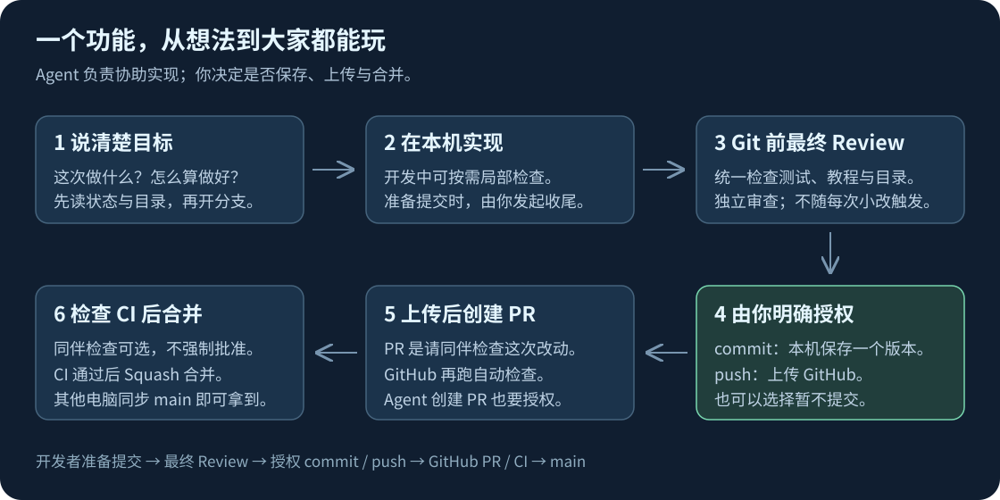

# 给另一位开发者：五分钟认识项目

**Agent 帮你写代码，Git 保存版本，GitHub 让三个人共享版本，Godot 把代码和场景运行成游戏。** 你负责提出想法、理解教程并试玩确认。

## 第一次打开

1. 使用自己的 GitHub 账号，请仓库所有者邀请你加入协作。
2. 安装 Git 和 **Godot 4.7.1 stable 标准版**。把 `AI_SETUP.md` 发给你电脑上的 AI，让它检查环境；Godot MCP 是选配。
3. 克隆仓库到你喜欢的目录。可以请 AI 执行，或在 GitHub Desktop 中 File → Clone repository → URL 填 `https://github.com/Ziran-Ziran/playAball`。
4. Godot → 导入 → 选择下载目录中的 `project.godot` → 编辑 → F5。按住球往后拖，松手击球，R 重来。

## 每次做一个功能

先同步 main，再开任务分支。你可以直接对 AI 说：

> 先读 AGENTS.md、STATUS 和 FILE_MAP，检查本机环境和已有修改。按 Git 公约开任务分支，帮我做【具体功能】。完成后测试、写新手教程、更新目录与状态，完成独立 Review 和复测，再汇报并询问我是否 commit、是否 push。不要擅自提交、上传或覆盖其他人的修改。

然后看 `docs/tutorials/` 的教程，回到 Godot 按 F5 试玩。觉得不对就描述“我做了什么、期望什么、实际发生什么”。Review 完成后，你决定“只 commit 保存到本机”或“commit 并 push 上传到 GitHub”；也可以暂不提交。需要 Agent 创建 PR 时明确告诉它。接着在 GitHub 的 PR 页面让另一位同伴检查，通过后由你们确认合并。另一台电脑拉取更新就能拿到新功能。

PR 就是“请同伴检查这次改动”。绿色 CI 是自动检查通过，仍需要人试玩手感。Git 公约中有可复制的命令；不会操作时让 AI 逐步解释即可。

## 你最常看的入口

- `docs/STATUS.md`：现在做到哪、下一步是什么。
- `docs/FILE_MAP.md`：文件树与每个文件负责什么。
- `docs/tutorials/001-prototype.md`：这版怎么实现、参数去哪里改。
- `CONTRIBUTING.md`：分支、提交、PR 和冲突处理。
- `docs/REVIEW.md`：每次如何检查、测试和决定是否提交。

不需要把聊天记录搬来搬去。换 AI 时让它读仓库文档；换电脑时让它先确认电脑环境。
