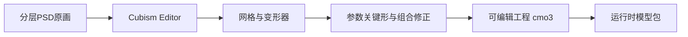

# Live2D从原画到菜单互动：架构入门

## 2026-11-04：现成模型与本工程的实际状态

基础架构说明仍适用。自有菜单角色尚未绑定；Haru旧示例已跑通参数与独立Windows导出，重复释放时的原生内存增长尚未归因，完整L0仍未通过。当前适配版本与复现见[教程034](034-live2d-l0-and-audio-samples.md)，不要把架构图当已经做好的菜单。

已找到氵六青DS鲸鱼娘和Mao绒绒家园大肥鱼两个候选来源，详细来源、文件清点、授权边界和可编辑源文件缺口见[模型调研](../art/live2d_model_research.md)。现成moc3是运行数据，公开仓库未见的cmo3/PSD不能假定存在；代码能驱动已有参数，新增精细脸颊关键形仍需真正的绑定制作。本轮只读取公开元数据，未安装桌宠插件、未换技术栈或接入正式菜单。

以下保留此前制作/架构说明；验收现状以上述最新记录为准。

Live2D把分层二维画面制作成可连续变形的模型。我们用它做菜单角色的表情、视线、转头和头发惯性；战斗仍由Godot的真实刚体处理。你下载的Native SDK是运行模型所需的工具包，角色制作软件叫Cubism Editor。

## 制作阶段：把画做成能控制的模型

原画先拆出脸、眼白、瞳孔、眼睑、嘴、前后发、躯干和尾巴等部位，补齐遮挡后可能露出的区域。每块图像覆盖在三角网格上，移动网格顶点就能改变它的形状；变形器让操作者能成组控制这些网格。

绑定师为参数设定关键形。例如转头参数取左/中/右时，分别制作眼鼻位置、脸轮廓、耳朵遮挡、头发透视，再修正转头和眨眼同时发生的组合。运行时会计算中间形状，因此鼠标连续移动时可以平滑转头。质量取决于这些形状和组合的设计，安装SDK不会自动把一张PNG变成精细角色。

## 运行阶段：输入如何变成画面

在我们的接法里，Godot决定“鼠标在哪、是否打开设置、这次点到哪块、该播放什么反应”。gd_cubism是把GDScript连接到Cubism Native能力的社区GDExtension。Framework提供动作、表情、自动眨眼、呼吸和模型物理等配套逻辑；Core读取编译模型，并根据参数计算顶点等信息。桥接再把纹理、网格、绘制顺序和遮罩交给Godot显示。具体更新与绘制分工以桥接实际实现为准。

例如戳左脸：Godot先做局部命中检测和冷却校验，交互组件压低其他动作的优先级，改变模型已有的左脸挤压/眉眼/嘴角参数，Core算出变形后的网格；手指松开后用曲线平滑回到正常状态。如果模型没有相应的脸部关键形，需要回Editor补绑定。

这里的“物理”通常指头发、衣物、尾巴等二级运动参数的惯性与回弹；它不会接管游戏里的RigidBody2D碰撞，也不应反过来结算伤害。

## 这些文件分别装什么

| 文件 | 用途 | 交给谁 |
| --- | --- | --- |
| .psd | 分层原画，可补画和修改部件 | 原画与绑定操作者 |
| .cmo3 | Cubism模型编辑工程，含可编辑绑定 | 绑定操作者；必须保留 |
| .can3 | 使用了Cubism动画编辑时的动画工程 | 动画操作者；按实际使用交付 |
| .moc3 | 编译后的运行模型 | 游戏运行时 |
| .model3.json | 模型包入口，引用moc3、纹理及配置 | Godot通过桥接加载 |
| .png | 模型纹理图集 | 游戏运行时 |
| .physics3.json | 模型物理设置，如发梢惯性 | Framework/桥接 |
| .motion3.json / .exp3.json | 参数动作曲线 / 表情配置 | Framework/桥接 |

不是每个模型都必须有所有可选文件。只有视频只能播放固定演出，不能替代这些可交互资源；只有moc3也不足以完整继续编辑绑定。

## 我们为什么先做L0

当前固定引擎为Godot4.7.1标准版、Compatibility。gd_cubism不是Godot或Live2D官方完整集成；SDK、Core、Framework、桥接和模型导出目标之间可能有接口或渲染差异。因此先用SDK附带、条款允许的示例验证加载、遮罩、参数、导出与释放，再投入自有角色绑定。

你下载的包为CubismSdkForNative-5-r.5，Core声明06.00.0001。原版gd_cubism v0.9.1与该包Framework直接构建已发现接口不匹配；正在.local中测试适配组合，不能把“有DLL”当作L0通过。实际版本、失败和成功证据见[教程034](034-live2d-l0-and-audio-samples.md)。

用户负责角色审美、软件许可与必要的操作者选择；Agent负责素材整理、Godot接入和可复现技术验证。当前没有已验证的专业Cubism自动绑定能力，不能承诺一键完成网格、转头关键形与组合修正。

参考：[官方SDK组成](https://docs.live2d.com/en/cubism-sdk-manual/sdkconstruction/)、[Core职责](https://docs.live2d.com/en/cubism-sdk-manual/cubism-core/)、[参数操作](https://docs.live2d.com/en/cubism-sdk-manual/parameters/)、[社区桥接](https://github.com/MizunagiKB/gd_cubism)。
