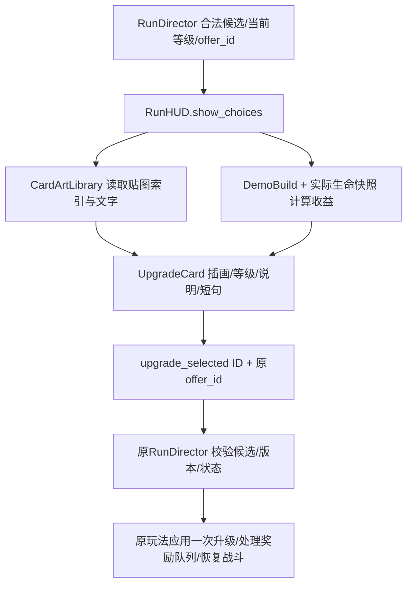

# 正式成长卡：贴图、收益与文字怎样接进游戏

## 目的与当前验收边界

本轮把独立图鉴的素材映射接到正式RunHUD。16种成长对应28张基础插画，有限等级各一张，饱餐/强身可重复项共用图。用户要求返修同质化后，先按[逐张描述R3](../art/card_briefs_r3.md)生成，再做语义检查。用户已授权实装，不等于每张图已获审美认可；实际完成范围、生成数量和检查证据以STATUS及production_r2.json最新字段为准。

标题沿用真实.tres，收益数值来自DemoBuild和生命快照，显示文案单独维护。玩法资源、等级上限、伤害、发射、经济和物理没有因为卡面接线而改动。

## 文件、节点与职责

| 文件 | 用途 |
| --- | --- |
| scripts/roguelite/run_hud.gd、scenes/roguelite/run_hud.tscn | 正式奖励/结算HUD；接收玩法给的候选与等级，创建按钮，原样发送选择请求 |
| scenes/roguelite/presentation/upgrade_card.tscn | 可编辑的单卡Button，保留现有手绘卡框纹理、键盘焦点与鼠标点击 |
| scripts/roguelite/presentation/upgrade_card.gd | 摆放插画和文字、缩小长文案字号；不应用Buff |
| scripts/roguelite/presentation/card_art_library.gd | 只读加载JSON、查找下一等级贴图并缓存；不生成候选 |
| resources/roguelite/card_art_catalog.json | 成长ID/等级→res://贴图路径，另记候选审美状态 |
| resources/roguelite/upgrade_card_copy.json | 16套面向玩家的规则说明和趣味短句，不参与伤害计算 |
| assets/cards/*.png及.import | 28张源插画与mipmap/512导入设置；旧稿在.local保留 |
| tests/roguelite_card_art.gd | 真实HUD的28项等级贴图、重复项与近满血收益检查 |
| export_presets.cfg、tools/package_probe.gd | 将两个FileAccess读取的JSON明确进包，检查真实包内28图可加载 |

单卡节点是UpgradeCard/Button→Content/Control，下面直接有Category、Heading、Illustration、Level、Preview、Detail、Flavor。所有子控件忽略鼠标，由外层Button接收点击，避免点到插画时按钮失效。原Content/Heading、Preview、Detail路径保留给既有集成测试。

## 输入→显示→选择的过程

关键是`next_level = levels.get(id, 0) + 1`：当前重击2级时，显示将获得的3级插画和2→3级收益，不显示旧等级的图。重复项的索引只有level1，库始终复用同图；界面写“可重复”，不伪造99→100/无限上限的等级条。

`benefit_preview`继续调用DemoBuild的真实方法：冷却、冲量、阻尼/摩擦、危险波缩放等用原公式。饱餐读取当前hp/max_hp，4/5生命只显示恢复1格；规则说明仍解释一般效果为恢复2、不超过上限。趣味短句没有数值，不可在里面偷偷新增能力。

原信号`upgrade_selected(id, offer_id)`不变。卡片不直接调用build.choose；重复点击、旧奖励按钮、队列、暂停与恢复仍由RunDirector验证。卡片入场只动画缩放与透明度，位置由HBoxContainer管理；Tween在暂停期间运行，按钮启用时机与原节奏一致。

## 检查器中怎样调

在upgrade_card.tscn选择根节点，可调Illustration Top/Height（占卡高比例）、Title Font Size、Detail Font Size。插画底部应留在等级行之上；不要为放大图而压到收益和规则文字。字号会在有限范围向下适配，不会把正文无限缩成不可读的小字。

在run_hud.tscn根节点可调Reward Panel Max Size、Reward Card Max Width；Cards/HBoxContainer的separation调卡间距。默认以1280×720逻辑窗口做三/四卡，单卡兜底居中且保持正常宽度。外层奖励面板按实际视口居中；结算仍使用原来的紧凑面板。

场景F6单独打开时没有玩法候选，完整预览应运行正式F5主菜单→开始→真实奖励，或使用文末测试夹具。不要把图鉴或空白卡场景当已经走过正式领奖流程。

## 改文字、换图、扩展等级

1. 改玩家规则说明或短句：编辑upgrade_card_copy.json对应ID的rules/flavor。rules必须核对原.tres和实现，不能把文案提案当玩法需求；保留现有标题。
2. 换某一级图：先按R3写好本张说明，用内置image_gen生成，记录prompt、参考、输出/哈希。保留旧图后更新相同canonical路径，重新导入；.import开启mipmap、size_limit512，卡片采样为LINEAR_WITH_MIPMAPS。实际缩图审美仍由用户决定。
3. 增加新机制/等级属于玩法任务，不能只在此JSON添加一项假装完成。由玩法负责人实现真实资源与规则后，再同步索引、贴图、文案和覆盖检查。
4. catalog中的approved/review_status是制作记录，当前实装授权允许显示候选；游戏不向玩家展示“技术通过/待审”等制作术语。不要把实装动作反写成用户已经喜欢所有新图。

## 复现与验证

先核验本机Godot4.7.1标准版实际路径，执行导入与`tools/verify.ps1 -GodotExe <实际路径>`。新增卡面检查为`--headless --path . --script tests/roguelite_card_art.gd`，遍历28个真实下一等级、标题/收益/规则、重复标签与4→5/5实际恢复量。旧HUD未接图时该测试29项失败；接线后144项通过。最终运行结果见最新STATUS，不用早期通过代替修改后的复测。

tests/ui_integration.gd检查主菜单鼠标开始、发射/暂停、16项真实文字排版、插画/等级/收益/说明不重叠、结算/回菜单；原feature_acceptance检查实际卡按钮→规则应用→恢复战斗。kill_run覆盖旧卡点击、连领奖和奖励只用一次；shop_events/stage_flow检查商店/补给入口。

.local/art_audio_r2/card_integration/formal_capture.gd是本地证据夹具：从正式主菜单进入Game，用真实候选或标明的强制列表布局夹具截图，记录边界、显示文字、贴图路径；可合成真实引擎鼠标按下/松开验证应用一次并恢复。不是真人鼠标试玩，也不是自然刷怪得奖/通关。1280×720与1024×576截图、失败/修复记录放同目录；不将本机绝对证据路径写入运行代码。

Windows包使用tools/export_windows.ps1。两个JSON必须被export_presets.cfg的include_filter明确包含；编辑器里FileAccess可读不代表导出后存在。package_probe由同版编辑器引擎通过--main-pack读取实际EXE内嵌资源，检查全部28图和关键规则文案；这不同于直接运行Release模板完成鼠标试玩。普通导出不加入Live2D隔离插件，用户的原project.godot不写回。若交付导出包，应同时记录实际版本、包指纹与未测范围，不能把探针当人类试玩。

本机首次用旧WindowsPowerShell5.1启动导出，Get-FileHash不可用；核验当前PowerShell7.6.5及哈希/压缩命令后导出成功。另一电脑先调查可用shell，不把本机命令路径写入脚本。Release导出忽略外部--script测试入口，本轮未加入正式游戏测试后门；原生窗口激活检查没有完成，不记录为独立EXE选卡通过。

新增JSON还是源指纹的一部分：export_windows.ps1的源文件扩展名清单现包含.json。此前两次暂存输入只改JSON时旧签名相同；独立读取同两份输入重算后，含JSON的签名不同，最终v4的指纹匹配。修改文案也必须能追溯到不同输入版本，不能只以EXE文件名区分。

## 常见问题

- 等级对但图错：检查取的是next_level，重复项只复用一张图；不要根据“点击次数”命名无限图片。
- 图在编辑器有、导出丢失：检查两个JSON是否进包及资源路径大小写。不要在运行代码引用.local或个人目录。
- 点击插画不选卡：所有被动子控件须MOUSE_FILTER_IGNORE，外层Button发送原选择信号。
- 标题挤到图或文字过小：先调布局/简化玩家说明，再检查两种窗口和四卡；技术边界检查不能替用户验收可读性与审美。
- 修改卡面后物理改变：这不属于表现文件的职责；还原无关规则改动，核验基线哈希。当前接线不改玩法资源。

Live2D交接另见[提示词](../onboarding/live2d_handoff_prompt.md)，本轮不推进其下载、绑定或运行实验。
